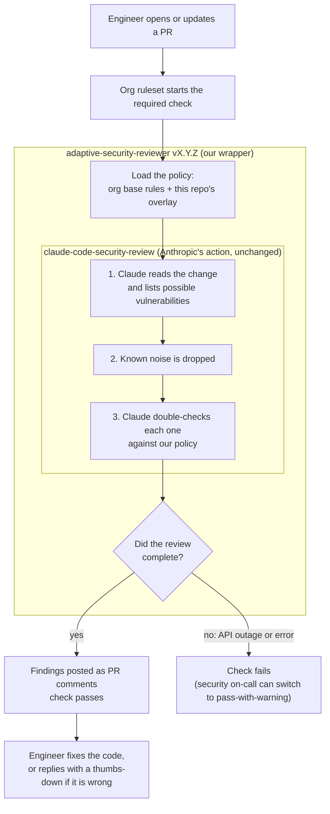
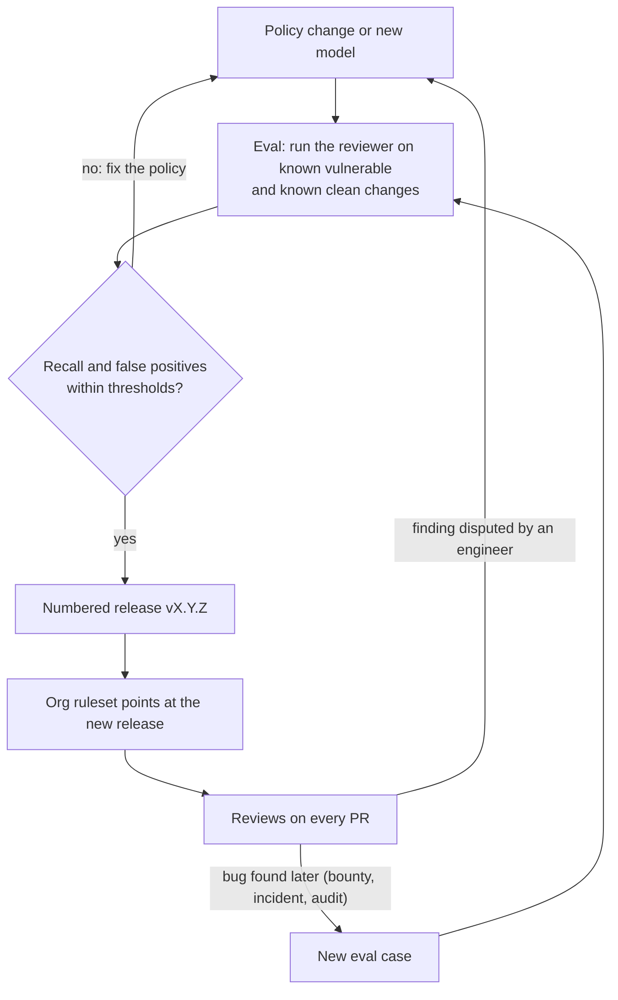

# adaptive-security-reviewer

Every pull request in [org] gets an automated Security Impact Assessment (SIA). It replaces the SIA ticket and the manual security review. Engineers do nothing extra: the review starts when the PR is opened, posts its findings as PR comments, and reports one required check.

## What happens on a pull request

Findings never block the merge. They are comments, the same way a security engineer's comments were. The check fails only when the review could not run, so no change merges without being assessed.

## How the review stays good

Each missed bug becomes a test case, and each wrong finding can become a policy fix. A change reaches PRs only as a numbered release that passed the eval.

## Documents

- [design.md](design.md): what is built and how it fits together
- [policy-authoring.md](policy-authoring.md): how to add or change a precedent, and how a repository adds its overlay
- [evaluation.md](evaluation.md): corpus format, judge, thresholds, how to add a case
- [runbook.md](runbook.md): outages, bypass, cost alerts, releases, contacts
- [engineer-faq.md](engineer-faq.md): for PR authors, covering what the bot does and how to respond
- [adr/](adr/README.md): the decisions behind the design, and why
