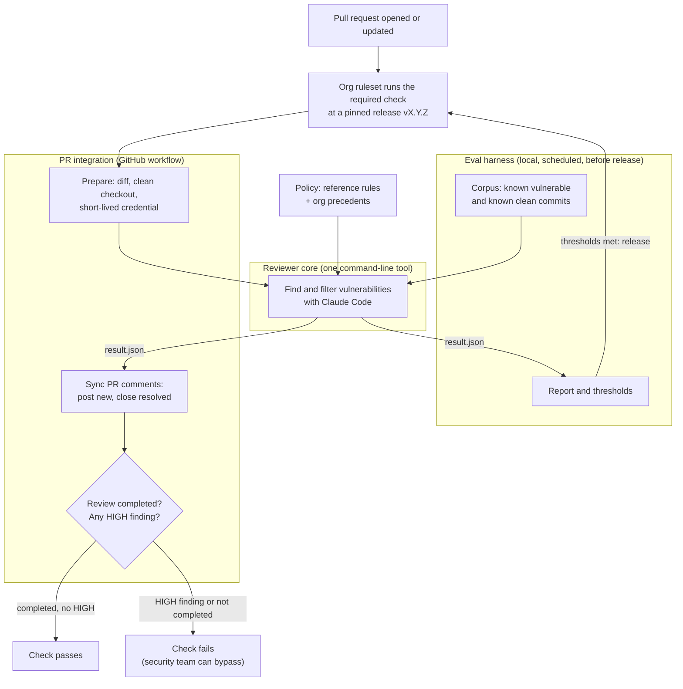

# Design

Status: draft for review. It covers requirements, architecture and the contracts between components. Operations, rollout details and results come later, once the reviewer core has been validated.

## Summary

Every pull request in [org] gets an automated security review that replaces the Security Impact Assessment (SIA) ticket and supplements the human code review every PR already has. The system has one reviewer core, a command-line tool that turns a code change into findings. Three users call that core with the same contract: the GitHub workflow on PRs, the eval harness that measures quality, and engineers running it locally. Everything else (comments, blocking, releases, rollout) sits around that core and never inside it.

## Requirements

What the system has to achieve, independent of how. The mechanisms are under "How the requirements are met" below.

- **R1.** Every change gets a security review before it merges, without anyone having to ask for it.
- **R2.** Engineers do nothing extra: no ticket, no labels, no manual trigger.
- **R3.** The review supplements the human code review every PR already gets. It does not replace it.
- **R4.** The reviewer speaks only when it has something to say. A PR without findings gets no comment.
- **R5.** What the PR shows is current. A finding introduced by a later push appears, and a finding that was fixed is marked resolved.
- **R6.** A change with a confirmed serious vulnerability does not merge. No finding blocks a PR for longer than [N] working hours: if the Adaptive Security team has not decided by then, the PR is unblocked and the finding is reviewed after the merge.
- **R7.** A review that did not happen is never mistaken for a clean review.
- **R8.** No long-lived model credential exists that could leak.
- **R9.** Code under review cannot change how it is reviewed, or reach the reviewer's credentials.
- **R10.** Review quality is measured, not assumed: how many known vulnerabilities it finds, how many false alarms it raises, and what each review costs.
- **R11.** Every change to the reviewer is measured before it reaches PRs, and for any PR it is possible to tell which version reviewed it.
- **R12.** What is measured is what runs: the same reviewer runs in the eval, on PRs, and on an engineer's machine.
- **R13.** Every PR keeps a record of the SIA criteria it touched, which replaces the ticket's checkboxes.
- **R14.** Rollout steps and incident response (turning comments, blocking or fail-closed behaviour on and off) need no code release.
- **R15.** The rules the reviewer applies are owned by the Adaptive Security team, and can be extended with company-specific knowledge.
- **R16.** The Adaptive Security team can see what the reviewer reviewed and found across all repositories, assess the findings, and turn real vulnerabilities, missed ones and false alarms into eval cases.
- **R17.** A PR author can report a finding as a false positive from the PR. The Adaptive Security team decides, the decision is recorded, and a dismissed finding is not reported or blocking again on that PR.

## Architecture



The reviewer core is the only component that calls a model. The PR integration and the eval both call it with the same inputs and read the same `result.json`, so the eval measures exactly what runs on PRs.

### How the requirements are met

| Requirement | Mechanism | ADR |
|---|---|---|
| R1 Every change reviewed | The review is a required status check, enforced by an org ruleset on every repository | [0005](adr/0005-required-check-semantics.md), [0009](adr/0009-rollout-gates.md) |
| R2 Nothing extra for engineers | The workflow starts on PR events by itself | [0005](adr/0005-required-check-semantics.md) |
| R3 Supplements human review | Existing review requirements stay unchanged. The reviewer does not request reviewers | [0002](adr/0002-classifier-vs-single-policy.md) |
| R4 Speaks only with findings | Comments are posted only for findings. The SIA criteria go to the job summary | [0002](adr/0002-classifier-vs-single-policy.md), [0005](adr/0005-required-check-semantics.md) |
| R5 PR shows the current state | The comment sync step posts new findings and resolves fixed ones | [0005](adr/0005-required-check-semantics.md) |
| R6 Serious vulnerabilities do not merge, and blocks are short | HIGH findings fail the required check. A false-positive request, or a bypass by the Adaptive Security team, ends the block. The time limit is not designed yet (see "Components still to design") | [0005](adr/0005-required-check-semantics.md) |
| R7 No silent failure | The core returns `status: error` and exit code 3. The check fails closed, with an org switch for outages | [0006](adr/0006-fail-open-vs-fail-closed.md) |
| R8 No long-lived credential | Workload identity federation: a short-lived token per job | [0010](adr/0010-local-vs-ci-authentication.md) |
| R9 Code cannot steer the reviewer | Agent configuration is deleted before the review, Claude Code runs in restricted mode, and the credential is kept out of steps that hold the GitHub token | [0001](adr/0001-reviewer-core.md) |
| R10 Quality measured | Eval corpus, LLM judge, and report with recall, false positives and cost | [0007](adr/0007-eval-corpus-and-judge.md), [0008](adr/0008-measuring-precision.md) |
| R11 Changes measured before PRs | Releases are tagged only after the eval passes, and the ruleset pins a release | [0012](adr/0012-versioned-releases.md) |
| R12 Same reviewer everywhere | One reviewer core with one contract, called by the PR workflow, the eval and engineers | [0007](adr/0007-eval-corpus-and-judge.md) |
| R13 SIA record per PR | The review returns `criteria_touched`, written to the job summary and the result artifact | [0002](adr/0002-classifier-vs-single-policy.md) |
| R14 No release for rollout or incidents | Organization variables switch comments, blocking and fail mode | [0009](adr/0009-rollout-gates.md) |
| R15 Rules owned by security | Policy text in the central repository: upstream's reference rules, plus org precedents and repository overlays added by the Adaptive Security team | [0003](adr/0003-precedents-vs-rules.md), [0011](adr/0011-policy-layering.md) |
| R16 Monitoring and assessment | Not designed yet. Candidates: the PR workflow sends each `result.json` to a central results store, and the Adaptive Security team assesses findings there; assessed findings are converted into corpus cases | see "Components still to design" |
| R17 False-positive requests | Not designed yet. Candidates: the author replies to the finding with a fixed command; the Adaptive Security team approves or rejects it; the comment sync step remembers dismissed findings and stops reporting and blocking on them | see "Components still to design" |

## Components and contracts

### Reviewer core

One command-line tool. It does not know about GitHub.

- **Inputs:** a directory with the code at the PR head, a unified diff, the policy directory, the model and effort level. Credentials come from the environment: an API key, a short-lived token, or a local Claude login.
- **Output:** `result.json`, and an exit code: 0 if the review completed, 3 if it did not.
- **What happens inside:** Claude Code reviews the change with the policy's rules, then filters its own candidates against the false-positive rules. Agent configuration in the code directory is ignored. How this is implemented is the open decision in [0001](adr/0001-reviewer-core.md): a changed copy of the upstream action (Option C), or a headless Claude Code reviewer built from upstream's `security-review` command (Option D). Both must meet this contract.

`result.json`:

```json
{
  "status": "completed",
  "model": "claude-opus-5-5",
  "effort": "high",
  "cost_usd": 0.42,
  "criteria_touched": [
    {"id": "authorization", "reason": "New support endpoint changes another user's account"}
  ],
  "findings": [
    {
      "severity": "HIGH",
      "criterion": "authorization",
      "file": "src/Endpoints/SupportEndpoints.cs",
      "line": 12,
      "title": "Any logged-in user can reset another user's password",
      "exploit_steps": ["Log in as an ordinary user", "POST /api/support/users/{id}/reset-password", "Log in as the victim"],
      "recommendation": "Require the Support policy on the route group",
      "confidence": 0.95
    }
  ],
  "dropped": []
}
```

When `status` is `error`, `findings` is empty and an `error` field says why. Nothing downstream treats an error as a clean review (R7).

### PR integration

A composite GitHub Action, called by the workflow the org ruleset requires.

1. **Prepare:** refuse fork PRs, check out the PR head, compute the diff against the base, delete agent configuration (`.claude/`, `CLAUDE.md`, `.mcp.json`) from the checkout, and get a short-lived credential (R8, R9).
2. **Review:** call the reviewer core.
3. **Sync comments:** match the findings against the bot's earlier comments, post new ones, reply to and resolve the ones no longer reported, and keep one summary comment once the PR has had findings (R4, R5).
4. **Decide the check:** fail when the review did not complete (unless fail mode is open), and fail on a HIGH finding when blocking is on (R6, R7, R14).
5. **Record:** write the criteria touched and the findings to the job summary, and upload `result.json` (R13).

### Eval harness

Turns each corpus case (a base commit, a head commit, and the expected result) into a code directory and a diff, calls the reviewer core, grades the result with an LLM judge, and writes a report with recall, false positives and cost per case. It runs locally, on a schedule, and as the gate before a release (R10, R11, R12).

### Policy

Text in this repository: the reference rules from upstream's `security-review` command, plus org precedents, switched off until [org] fills them in. Overlays for individual repositories live here too, owned by the Adaptive Security team. They are planned, not built (R15).

### Release and enforcement

A release workflow runs the eval and tags `vX.Y.Z` only if the thresholds are met. The org ruleset requires the PR workflow at a pinned release. Organization variables switch comments, blocking and fail mode (R11, R14).

### Components still to design

Both add state that lives outside a single review run. The rest of the design keeps none.

**Results store and assessment (R16).**
- Where results go. Options: each PR workflow run sends its `result.json` to a central store, or a scheduled job collects the result artifacts from every repository. Either way, artifacts alone are not enough, because GitHub deletes them after their retention period. [decide: the store, and the credential the PR workflow uses to write to it.]
- What is kept per review: repository, PR, commit, reviewer version (R11), model, cost, criteria touched, findings, and later the assessment and any false-positive request.
- How the Adaptive Security team assesses findings, labelling each as a true or false positive. [decide: the tool, for example a queue of GitHub issues in this repository, or a small view over the store.]
- How an assessed finding becomes an eval case: the eval corpus converter turns a commit, the finding's description and the expected result into a case file (R10).
- This also gives precision from real PRs, which the eval alone cannot measure ([0008](adr/0008-measuring-precision.md)).

**False-positive requests (R17).**
- How the author raises one: for example, a reply on the finding's comment with a fixed command and a reason. The request is recorded in the results store and the Adaptive Security team is notified in [Adaptive Security team channel].
- Who decides: a member of the Adaptive Security team, usually the rotation engineer. Checking that the approver belongs to the team needs a token that can read team membership, which the workflow's own token cannot do. [decide: a GitHub App owned by the Adaptive Security team, or another way to verify the approver.]
- How a dismissal sticks: the comment sync step matches each new finding against the dismissed ones for that PR, by the same fingerprint it uses to track findings across pushes, and neither posts nor blocks on a match. Matching is the open problem already recorded in [0005](adr/0005-required-check-semantics.md): the model rewords findings between runs.
- How it relates to the bypass in [0005](adr/0005-required-check-semantics.md): an approved dismissal removes the need for a bypass on that finding, so the bypass remains for emergencies and for findings that cannot be matched.
- **Time limit (R6).** A blocked PR must not wait longer than [N] working hours. Options:
  - A request releases the block at once. Raising a false-positive request turns the finding into a warning, and the PR can merge while the request is reviewed after the fact. This is the fastest for engineers. The risk is that an author can request dismissal of a real bug to merge it, so every request is reviewed, and a rejected one after merge becomes a follow-up fix with an owner.
  - The block expires. The finding blocks until the team decides or [N] working hours pass. After that the check passes with a warning, and the request stays in the review queue.
  - Escalation only. The rotation engineer is paged when the limit is near, and the block stays until someone decides. This does not guarantee the limit.

  [decide: the option, and N.]
- Every decision feeds back: approved dismissals count as false positives, rejected ones as confirmed findings, and repeated false positives lead to a policy precedent or an eval case.

## What is verified and what is not

| Claim | Status |
|---|---|
| Claude Code can review a PR and find a planted authorization bug with the right root cause | Verified, in a test run of the upstream action |
| Headless Claude Code with `--restricted` ignores a `CLAUDE.md` in the reviewed code | Verified once, locally |
| The upstream action is broken (retired filter model, failures that look clean) and unmaintained | Verified, in code, test runs and its public issue tracker |
| A subscription token cannot authenticate the upstream action | Verified, in a test run |
| A headless reviewer built from the `security-review` command meets the core contract (JSON output, sub-agents in restricted mode) | Not verified |
| The reviewer finds more than one kind of bug and stays quiet on clean changes | Not verified |
| The workflow token can resolve and reply to review threads | Not verified |
| An org ruleset can require the workflow and allow a security-team bypass on [GitHub plan] | Not verified |
| Claude Code accepts a federated short-lived token | Not verified; needs an Anthropic API organization |
| Cost per review | Unknown |
| Findings can be matched across runs well enough to keep dismissals and close resolved findings | Not verified |

## Next

Validate the reviewer core first, because every other component depends on its contract: build the headless version against the contract above, run it on the existing demo PR and on a few more synthetic changes, and compare. Then test the PR integration's comment sync and the ruleset bypass on the demo repository, including whether findings can be matched across runs, since the false-positive dismissals (R17) depend on it. The results store (R16) and the false-positive request flow (R17) are designed after that. The ADRs are revised after that, to match what worked.
