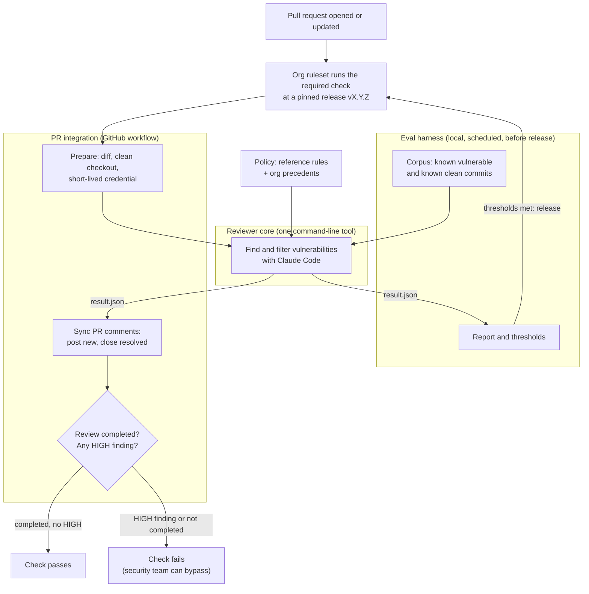

# Design

Status: draft for review. It covers requirements, architecture and the contracts between components. Operations, rollout details and results come later, once the reviewer core has been validated.

## Summary

Every pull request in [org] gets an automated security review that replaces the Security Impact Assessment (SIA) ticket and supplements the human code review every PR already has. The system has one reviewer core, a command-line tool that turns a code change into findings. Three users call that core with the same contract: the GitHub workflow on PRs, the eval harness that measures quality, and engineers running it locally. Everything else (comments, blocking, releases, rollout) sits around that core and never inside it.

## Requirements

Each requirement comes from a decision already made. The ADR that records the details is linked.

| # | Requirement | ADR |
|---|---|---|
| R1 | Every PR to a protected branch is reviewed, enforced by an org ruleset. Engineers do nothing extra. | [0005](adr/0005-required-check-semantics.md) |
| R2 | The review supplements human code review. It comments only when it has findings, and a clean PR gets no comment. | [0002](adr/0002-classifier-vs-single-policy.md) |
| R3 | Findings are tracked across pushes: new ones are posted, and ones a later scan no longer reports are closed. | [0005](adr/0005-required-check-semantics.md) |
| R4 | HIGH findings block the merge, once rollout has measured their precision. The security team can bypass through a recorded process. | [0005](adr/0005-required-check-semantics.md) |
| R5 | A review that did not complete never looks like a clean one. | [0006](adr/0006-fail-open-vs-fail-closed.md) |
| R6 | Anthropic models only. Production uses short-lived credentials (workload identity federation), with no stored API key. | [0010](adr/0010-local-vs-ci-authentication.md) |
| R7 | The same reviewer code runs on PRs, in the eval, and on an engineer's machine. | [0007](adr/0007-eval-corpus-and-judge.md) |
| R8 | Quality is measured on a labelled corpus: on a schedule, and before every release. | [0007](adr/0007-eval-corpus-and-judge.md) |
| R9 | Changes reach PRs only as numbered releases that passed the eval. | [0012](adr/0012-versioned-releases.md) |
| R10 | Every PR gets a record of the SIA criteria it touched, kept in the job summary, not posted. | [0002](adr/0002-classifier-vs-single-policy.md) |
| R11 | The review rules start from upstream's `security-review` command. Org precedents are added later, owned by [security-team]. | [0011](adr/0011-policy-layering.md) |
| R12 | Code in a PR cannot change the reviewer's instructions, settings, tools or credentials. | [0001](adr/0001-reviewer-core.md) |
| R13 | Comments on or off, blocking on or off, and fail mode can be changed without a release. | [0009](adr/0009-rollout-gates.md) |

## Architecture



The reviewer core is the only component that calls a model. The PR integration and the eval both call it with the same inputs and read the same `result.json`, so the eval measures exactly what runs on PRs.

## Components and contracts

### Reviewer core

One command-line tool. It does not know about GitHub.

- **Inputs:** a directory with the code at the PR head, a unified diff, the policy directory, the model and effort level. Credentials come from the environment: an API key, a short-lived token, or a local Claude login.
- **Output:** `result.json`, and an exit code: 0 if the review completed, 3 if it did not.
- **What happens inside:** Claude Code reviews the change with the policy's rules, then filters its own candidates against the false-positive rules. Agent configuration in the code directory is ignored. How this is implemented is the open decision in [0001](adr/0001-reviewer-core.md): a changed copy of the upstream action (Option C), or a headless Claude Code reviewer built from upstream's `security-review` command (Option D). Both must meet this contract.

`result.json`:

```json
{
  "status": "completed",
  "model": "claude-opus-5-5",
  "effort": "high",
  "cost_usd": 0.42,
  "criteria_touched": [
    {"id": "authorization", "reason": "New support endpoint changes another user's account"}
  ],
  "findings": [
    {
      "severity": "HIGH",
      "criterion": "authorization",
      "file": "src/Endpoints/SupportEndpoints.cs",
      "line": 12,
      "title": "Any logged-in user can reset another user's password",
      "exploit_steps": ["Log in as an ordinary user", "POST /api/support/users/{id}/reset-password", "Log in as the victim"],
      "recommendation": "Require the Support policy on the route group",
      "confidence": 0.95
    }
  ],
  "dropped": []
}
```

When `status` is `error`, `findings` is empty and an `error` field says why. Nothing downstream treats an error as a clean review (R5).

### PR integration

A composite GitHub Action, called by the workflow the org ruleset requires.

1. **Prepare:** refuse fork PRs, check out the PR head, compute the diff against the base, delete agent configuration (`.claude/`, `CLAUDE.md`, `.mcp.json`) from the checkout, and get a short-lived credential (R6, R12).
2. **Review:** call the reviewer core.
3. **Sync comments:** match the findings against the bot's earlier comments, post new ones, reply to and resolve the ones no longer reported, and keep one summary comment once the PR has had findings (R2, R3).
4. **Decide the check:** fail when the review did not complete (unless fail mode is open), and fail on a HIGH finding when blocking is on (R4, R5, R13).
5. **Record:** write the criteria touched and the findings to the job summary, and upload `result.json` (R10).

### Eval harness

Turns each corpus case (a base commit, a head commit, and the expected result) into a code directory and a diff, calls the reviewer core, grades the result with an LLM judge, and writes a report with recall, false positives and cost per case. It runs locally, on a schedule, and as the gate before a release (R7, R8, R9).

### Policy

Text in this repository: the reference rules from upstream's `security-review` command, plus org precedents, switched off until [org] fills them in. Overlays for individual repositories live here too, owned by [security-team]. They are planned, not built (R11).

### Release and enforcement

A release workflow runs the eval and tags `vX.Y.Z` only if the thresholds are met. The org ruleset requires the PR workflow at a pinned release. Organization variables switch comments, blocking and fail mode (R9, R13).

## What is verified and what is not

| Claim | Status |
|---|---|
| Claude Code can review a PR and find a planted authorization bug with the right root cause | Verified, in a test run of the upstream action |
| Headless Claude Code with `--restricted` ignores a `CLAUDE.md` in the reviewed code | Verified once, locally |
| The upstream action is broken (retired filter model, failures that look clean) and unmaintained | Verified, in code, test runs and its public issue tracker |
| A subscription token cannot authenticate the upstream action | Verified, in a test run |
| A headless reviewer built from the `security-review` command meets the core contract (JSON output, sub-agents in restricted mode) | Not verified |
| The reviewer finds more than one kind of bug and stays quiet on clean changes | Not verified |
| The workflow token can resolve and reply to review threads | Not verified |
| An org ruleset can require the workflow and allow a security-team bypass on [GitHub plan] | Not verified |
| Claude Code accepts a federated short-lived token | Not verified; needs an Anthropic API organization |
| Cost per review | Unknown |

## Next

Validate the reviewer core first, because every other component depends on its contract: build the headless version against the contract above, run it on the existing demo PR and on a few more synthetic changes, and compare. Then test the PR integration's comment sync and the ruleset bypass on the demo repository. The ADRs are revised after that, to match what worked.
